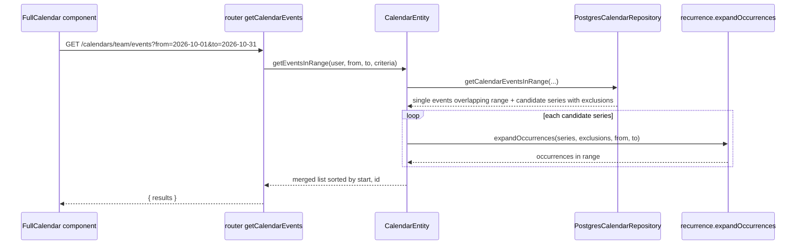

# Calendar Service — Event Recurrence Design

- **Ticket:** Calendar Service — basic event recurrence
- **Primary consumer:** reusable Calendar component built on FullCalendar
- **Story scope (AC 13):** create (`POST`), update the whole series (`PATCH`), delete the whole series (`DELETE`), cancel one occurrence (`DELETE .../occurrences/{date}`), and expand occurrences in bounded range queries
- **Out of scope:** raw RRULE, "nth weekday" rules, modifying one occurrence, "this and following", restoring a cancelled occurrence, business-day rules, recurrence UI

---

## Table of Contents

- [1. Decisions at a Glance](#1-decisions-at-a-glance)
- [2. Current State](#2-current-state)
- [3. API Contract](#3-api-contract)
- [4. Recurrence Semantics (RFC 5545 Subset)](#4-recurrence-semantics-rfc-5545-subset)
- [5. Expansion](#5-expansion)
- [6. Persistence](#6-persistence)
- [7. Code Changes by File](#7-code-changes-by-file)
- [8. Validation and Errors](#8-validation-and-errors)
- [9. FullCalendar Integration](#9-fullcalendar-integration)
- [10. Tests](#10-tests)
- [11. Acceptance Criteria Mapping](#11-acceptance-criteria-mapping)
- [12. Manual Testing](#12-manual-testing)
- [13. Implementation Order](#13-implementation-order)
- [14. Resolved Decisions and Risks](#14-resolved-decisions-and-risks)

---

## 1. Decisions at a Glance

| # | Decision | Why |
|---|---|---|
| D1 | Store the rule as structured JSON on the event row (`recurrence jsonb`), not RRULE text. | ADSP-friendly API. Each field maps 1:1 to an RFC 5545 RRULE part. |
| D2 | Expand on read, in the model layer, with a pure luxon function. No `rrule` dependency. | luxon is already used. Its calendar math keeps local wall time across DST. The subset is small. |
| D3 | Store exclusions in a child table `calendar_event_exclusions`, keyed by **local occurrence date**. | Atomic insert, cascade delete, no JSON read-modify-write race. The subset generates at most one occurrence per local date. |
| D4 | Occurrence identity = parent `id` + `recurrenceId` (RFC RECURRENCE-ID) + occurrence `urn`. | `id` keeps its type and meaning, so nothing breaks. Leaves room for occurrence operations later. |
| D5 | Only the `from`/`to` range query expands. The paged `top`/`after` list still returns one row per event (the series). | AC 11: existing consumers (form-service intake, TMW) are unchanged. |
| D6 | Cancel one occurrence with `DELETE /calendars/{name}/events/{id}/occurrences/{occurrence}`. | Same REST shape as attendees. Maps to EXDATE. |
| D7 | Domain events: reuse `calendar-event-updated` with `operation: 'exclude-occurrence'`. | Same pattern as the attendee operations. No new event definition. |
| D8 | Everything runs in **Mountain time** (`America/Edmonton`): input conversion, storage, expansion, `until` dates, exclusion dates, and response offsets. | Matches existing `TIME_ZONE`. A 10:00 meeting stays 10:00 Mountain all year, whether the zone is MDT (`-06:00`) or MST (`-07:00`). |

---

## 2. Current State

| Location | What it does today | Impact |
|---|---|---|
| [utils.ts](../apps/calendar-service/src/utils.ts) | Stores date/time as `yyyyMMdd` / `HHmm` integer ids in `TIME_ZONE` (default `America/Edmonton`). | Expansion runs in `TIME_ZONE` too. |
| [router/calendar.ts](../apps/calendar-service/src/calendar/router/calendar.ts) | `GET .../events?from=&to=` (max 366 days) returns `{ results }` with no paging. Without `from`/`to`, it pages with `top`/`after`/`criteria`. | The range branch becomes the expanding query. The paged branch is unchanged. |
| [model/calendar.ts](../apps/calendar-service/src/calendar/model/calendar.ts) | `getEventsInRange` delegates to the repository. | Expansion and merging go here. |
| [postgres/calendar.ts](../apps/calendar-service/src/postgres/calendar.ts) | `getCalendarEventsInRange` runs an SQL overlap predicate on `start_*`/`end_*`. | Add a second branch for recurring series. |
| [form-service calendar.ts](../apps/form-service/src/calendar.ts) | Uses the paged query with `activeOn` / `startsAfter`. | Must keep working unchanged (D5). |
| `exportCalendar` | Uses `ical-generator` 3.6.1, which supports `repeating` (RRULE + EXDATE). | Export can emit real RRULEs. |

The ticket example uses `start`/`end` query params and `calendarId`. The service uses `from`/`to` and the calendar `name`. Keep the existing names.

---

## 3. API Contract

### 3.1 Recurrence object

```ts
type DayOfWeek = 'MO' | 'TU' | 'WE' | 'TH' | 'FR' | 'SA' | 'SU';

interface EventRecurrence {
  frequency: 'daily' | 'weekly' | 'monthly' | 'yearly'; // FREQ
  interval?: number; // INTERVAL. Default 1. Range 1–99.
  daysOfWeek?: DayOfWeek[]; // BYDAY. Weekly only. Default = weekday of start.
  end?: {
    until?: string; // UNTIL. ISO date (yyyy-MM-dd), inclusive, local to TIME_ZONE.
    count?: number; // COUNT. 1–1000.
  };
  exclusions?: string[]; // EXDATE. Read-only: recurrenceIds of cancelled occurrences.
}
```

`CalendarEvent` gets an optional `recurrence?: EventRecurrence`. If `recurrence` is missing or null, the event is a normal single event.

### 3.2 Create

`POST /calendar/v1/calendars/{name}/events`

```json
{
  "name": "Team meeting",
  "start": "2026-09-29T10:00:00-06:00",
  "end": "2026-09-29T11:00:00-06:00",
  "recurrence": {
    "frequency": "weekly",
    "interval": 1,
    "daysOfWeek": ["TU"],
    "end": { "until": "2026-12-15" }
  }
}
```

The event `start`/`end` define the **first occurrence** (DTSTART/DTEND). The response is the series DTO (3.4).

### 3.3 Range query (expanded)

`GET /calendar/v1/calendars/team/events?from=2026-10-01&to=2026-10-31`

```json
{
  "results": [
    {
      "urn": "urn:ads:platform:calendar-service:v1:/calendars/team/events/42/occurrences/2026-10-06",
      "id": 42,
      "recurrenceId": "2026-10-06T10:00:00.000-06:00",
      "name": "Team meeting",
      "description": null,
      "start": "2026-10-06T10:00:00.000-06:00",
      "end": "2026-10-06T11:00:00.000-06:00",
      "isAllDay": false,
      "isPublic": false,
      "recordId": null,
      "context": null,
      "recurrence": {
        "frequency": "weekly",
        "interval": 1,
        "daysOfWeek": ["TU"],
        "end": { "until": "2026-12-15" }
      }
    }
  ]
}
```

Rules:

1. **Non-recurring events:** the DTO is byte-for-byte unchanged. It has no `recurrenceId` and no `recurrence`.
2. **Occurrences:** `id` = parent series id. `recurrenceId` = the occurrence's original start (RFC RECURRENCE-ID). `urn` points to the occurrence sub-resource.
3. **Exclusions:** `recurrence` on an occurrence omits `exclusions`. Cancelled occurrences are simply absent.
4. **Order:** results are sorted by `start`, then `id`.
5. **Attendees:** with `includeAttendees=true`, attendees load once per series and are shared by its occurrences, so there are no per-occurrence queries.

### 3.4 Get / update / delete the series

`PATCH` is in this story's scope, so the full create → edit → cancel → delete cycle can be tested end to end.

| Operation | Behaviour |
|---|---|
| `GET .../events/{id}` | Series DTO. `start`/`end` = first occurrence. `recurrence` includes `exclusions`. |
| `PATCH .../events/{id}` with `recurrence: {...}` | Replaces the whole rule. There is no deep merge. Also turns a single event into a recurring one. |
| `PATCH .../events/{id}` with `recurrence: null` | Becomes a single event (the first occurrence). Deletes its exclusions. |
| `PATCH .../events/{id}` with `start`/`end`/`name`/... | Applies to every occurrence. |
| `PATCH .../events/{id}` with `recurrence.end.until` set to a date | Stops the series after that date. Past occurrences stay. This is how users "cancel from a date onward" without needing "this and following". |
| `DELETE .../events/{id}` | **Cancels all occurrences at once.** Deletes the series row; exclusions and attendees go by FK cascade. |

Exclusions survive PATCH. They match by local date. If an exclusion no longer lands on an occurrence (for example, after the weekday changes), it has no effect.

### 3.5 Cancel one occurrence

`DELETE /calendar/v1/calendars/{name}/events/{id}/occurrences/{occurrence}`

- `{occurrence}`: the Mountain local date (`2026-10-13`) or a URL-encoded `recurrenceId`. Only the Mountain local date is used.
- Any occurrence can be cancelled: first, last, or mid-series.
- Requires an update role (same as event delete).
- Returns 200 `{ "deleted": true }`. If the occurrence is already cancelled, returns `{ "deleted": false }`.
- Returns 400 if the event is not recurring.
- Returns 404 if the event is missing, or the date is not an occurrence (including dates after `until`/`count`).
- Signals `calendar-event-updated` with `update: { operation: 'exclude-occurrence', recurrenceId }`.
- Cancellation is permanent. There is no restore operation.

**How it's tracked.** Cancelling the 2026-10-13 occurrence of event 42 inserts one row:

| tenant | event_id | occurrence_date |
|---|---|---|
| `urn:ads:platform:tenant-service:v2:/tenants/abc` | 42 | 20261013 |

The series row is unchanged. On every range query, expansion generates 2026-10-13, finds it in the exclusions, and drops it. `GET .../events/42` lists it under `recurrence.exclusions`. Deleting the series removes the row by cascade.

### 3.6 Paged list and export

- **Paged list (`top`/`after`):** returns series rows with `recurrence`, not occurrences. `startsAfter` / `endsBefore` / `activeOn` compare the **first occurrence** only. Consumers that need occurrences use `from`/`to`. Document this.
- **Export (`/export`):** map `recurrence` to ical-generator `repeating`: `freq`, `interval`, `byDay`, `until`, `count`, `exclude`, `startOfWeek: MO`. Without this, an exported recurring event shows only its first occurrence.

---

## 4. Recurrence Semantics (RFC 5545 Subset)

| API | RFC 5545 | Rule |
|---|---|---|
| event `start` | DTSTART | First occurrence. Always generated. |
| event `end` | DTEND | Every occurrence has the same duration. |
| `frequency` | FREQ | DAILY / WEEKLY / MONTHLY / YEARLY |
| `interval` | INTERVAL | Default 1. |
| `daysOfWeek` | BYDAY + WKST=MO | Weekly only. Must include the weekday of `start`. |
| monthly | BYMONTHDAY implied from DTSTART | Same day of month as `start`. Months without that day are skipped (the 31st skips Feb, Apr, Jun, Sep, Nov). |
| yearly | BYMONTH + BYMONTHDAY implied | Feb 29 occurs in leap years only. |
| `end.until` | UNTIL | Inclusive local date. |
| `end.count` | COUNT | Includes the first occurrence. **Excluded occurrences still count.** |
| `exclusions` | EXDATE | Removed after COUNT/UNTIL are applied. |

RFC 5545 rules this design follows: invalid dates "MUST be ignored" (not clamped), and COUNT and UNTIL "MUST NOT" appear together.

### 4.1 Mountain time and DST

All recurrence work happens in Mountain time (`TIME_ZONE = America/Edmonton`, already the default). Keep it unchanged.

| Where | Behaviour |
|---|---|
| Input | `start`/`end` in any offset are converted to Mountain. `2026-09-29T16:00:00Z` is stored as 10:00 MDT. |
| `until` and exclusion dates | Interpreted as Mountain calendar dates. |
| Output | Every `start`, `end`, and `recurrenceId` is returned with a Mountain offset: `-06:00` (MDT, Mar–Nov) or `-07:00` (MST, Nov–Mar). |

1. Expand with luxon calendar math (`plus({ days | weeks })`). It keeps local wall time: 10:00 stays 10:00 Mountain, and the offset changes from `-06:00` to `-07:00` on 2026-11-01.
2. Build monthly and yearly candidates with `DateTime.fromObject({ year, month, day: start.day, hour, minute }, { zone })`, and skip them when `!isValid`. **Do not use `start.plus({ months: n })`.** luxon clamps Jan 31 to Feb 28, which breaks the RFC rule.
3. Compute occurrence *n* from the anchor (`start + n × interval`), never from the previous occurrence. This avoids drift.
4. Duration = `end.diff(start, ['days', 'minutes'])`. Days are added as calendar days, so all-day and multi-day occurrences don't drift on 23- or 25-hour days.
5. A local time that doesn't exist (the 02:00–03:00 spring-forward gap) moves forward, as in luxon. This matches RFC 5545 §3.3.5.

---

## 5. Expansion

New file `apps/calendar-service/src/calendar/recurrence.ts`. It is pure and does no I/O.

```ts
export function expandOccurrences(
  start: DateTime,
  end: DateTime | null,
  rule: EventRecurrence,
  excludedDates: Set<number>, // yyyyMMdd
  from: DateTime,
  to: DateTime
): CalendarEventOccurrence[];

export function getRecurrenceEndDate(start: DateTime, end: DateTime | null, rule: EventRecurrence): number | null;
```

`expandOccurrences` steps:

1. Generate candidate starts in order from the anchor (section 4).
2. Stop when the candidate start is after `to`, after `until`, or `count` is reached. Increment the count **before** the exclusion check.
3. Drop candidates whose local date is in `excludedDates`.
4. Keep a candidate if it overlaps the range: `occStart <= to && (occEnd ?? occStart) >= from`. This is the same overlap rule as the non-recurring SQL.

`getRecurrenceEndDate` returns the date id of the last occurrence's end:

- `until`: until + duration days.
- `count`: expand to the last occurrence.
- No end: `null`.

It is stored on save and used to prefilter series in SQL.

Cost: iterations are bounded by (to − start) / period. The worst case, daily from 2020 to 2050, is about 11k cheap iterations per series. Skip-ahead for series without `count` is an optional later optimization.



---

## 6. Persistence

### 6.1 Migration

`apps/calendar-service/migrations/<timestamp>_add_event_recurrence.js`

```js
exports.up = function (knex) {
  return knex.schema
    .table('calendar_events', (table) => {
      table.jsonb('recurrence'); // null = not recurring
      table.integer('recurrence_end_date'); // yyyyMMdd of last occurrence end; null = no end
    })
    .createTable('calendar_event_exclusions', (table) => {
      table.string('tenant').notNullable();
      table.integer('event_id').notNullable();
      table.integer('occurrence_date').notNullable(); // yyyyMMdd local to TIME_ZONE
      table.primary(['tenant', 'event_id', 'occurrence_date']);
      table.foreign('event_id').references('id').on('calendar_events').onDelete('CASCADE');
    });
};

exports.down = function (knex) {
  return knex.schema.dropTable('calendar_event_exclusions').table('calendar_events', (table) => {
    table.dropColumn('recurrence_end_date');
    table.dropColumn('recurrence');
  });
};
```

- Store `recurrence` in API shape without `exclusions`, normalized: defaults applied and `daysOfWeek` sorted MO→SU.
- Do not add an FK from `occurrence_date` / `recurrence_end_date` to `calendar_dates`. A series may run past the seeded range.
- Existing rows get `recurrence = null`, so their behaviour is unchanged.

### 6.2 Range SQL

Replace the overlap predicate in `getCalendarEventsInRange` with two branches:

```sql
AND (
  (e.recurrence IS NULL AND <existing overlap predicate>)
  OR (
    e.recurrence IS NOT NULL
    AND e.start_date <= :toDate
    AND (e.recurrence_end_date IS NULL OR e.recurrence_end_date >= :fromDate)
  )
)
```

Then load exclusions for the candidate series in **one** query (`event_id IN (...)`). Attribute criteria (`recordId`, `context`, `isPublic`, `attendeeCriteria`) still apply in SQL to both branches.

In range mode, time criteria (`startsAfter`, `endsBefore`, `activeOn`) apply in SQL to the non-recurring branch only. The model applies them to generated occurrences.

### 6.3 Repository additions

```ts
getEventExclusions(events: CalendarEventEntity[]): Promise<Record<number, number[]>>;
saveExclusion(event: CalendarEventEntity, occurrenceDate: number): Promise<boolean>; // insert ... on conflict do nothing
deleteExclusions(event: CalendarEventEntity): Promise<void>;
```

`save()` writes `recurrence` and `recurrence_end_date`. `mapEventRecord` reads `recurrence`.

### 6.4 Running the migration

No manual SQL. The migration runs by itself.

1. [project.json](../apps/calendar-service/project.json) copies `apps/calendar-service/migrations` into the build output.
2. On startup, [postgres/index.ts](../apps/calendar-service/src/postgres/index.ts) calls `knex.migrate.latest()` (with retry).
3. knex records applied files in the `calendar_service_migrations` table and only runs new ones.
4. Locally: add the new file under `apps/calendar-service/migrations/`, then `npx nx serve calendar-service`. The log shows `Database migrations upped to latest.`
5. In dev/UAT/prod: the migration runs when the new image first starts.

The migration is additive (nullable columns + new table), so a rollback to the previous image still works against the migrated schema.

---

## 7. Code Changes by File

All paths are under `apps/calendar-service/` unless stated.

| File | Change |
|---|---|
| `src/calendar/types/event.ts` | Add `DayOfWeek`, `EventRecurrence`, `CalendarEventOccurrence`, and `CalendarEvent.recurrence?`. |
| `src/calendar/recurrence.ts` (new) | `validateRecurrence`, `expandOccurrences`, `getRecurrenceEndDate`. Pure functions. |
| `src/calendar/model/event.ts` | Add `recurrence` and `exclusions` fields. Validate in the constructor and `update`. Add `excludeOccurrence(user, occurrence)` and `getOccurrences(from, to)`. |
| `src/calendar/model/calendar.ts` | `getEventsInRange` returns single events plus expanded occurrences, merged and sorted. |
| `src/calendar/repository/calendar.ts`, `src/postgres/calendar.ts`, `src/postgres/types.ts` | New columns, two-branch range SQL, exclusion methods (section 6). |
| `src/calendar/router/calendar.ts` | Body schema for `recurrence.*`. Occurrence `DELETE` route. Occurrence mapper. Attendees loaded per series. Export `repeating`. |
| `src/calendar/events.ts` | Add `recurrence` to `eventSchema` and the mapper (both `calendar-event-updated` branches). Add `recurrenceId` to the operation branch, which has `additionalProperties: false`. |
| `src/calendar/router/calendar.swagger.yml` | `EventRecurrence` schema, `recurrenceId`/`recurrence` on `CalendarEvent`, occurrence `DELETE` path. |
| `docs/services/calendar-service.md` (repo root) | "Recurring events" section with the create example, range example, and cancel example. |
| `migrations/` | Section 6.1. |

---

## 8. Validation and Errors

Validation has two layers:

1. **Shape:** express-validator `checkSchema` only checks that `recurrence` is an object or null.
2. **Rules:** all recurrence rules are checked in one place, `normalizeRecurrence` in `recurrence.ts` (they need `start`), and thrown as `InvalidOperationError`.

| Status | Condition |
|---|---|
| 400 | `frequency` missing or not in the enum |
| 400 | `interval` not an integer from 1 to 99 |
| 400 | `daysOfWeek` on a non-weekly rule, or empty, duplicated, an unknown code, or missing the weekday of `start` |
| 400 | Both `until` and `count` given; `count` not 1–1000; `until` before the start date |
| 400 | `recurrence.exclusions` in a request body (it is read-only; use the occurrence `DELETE`) |
| 400 | Occurrence `DELETE` on a non-recurring event |
| 403 | User lacks an update role (existing `UnauthorizedUserError`) |
| 404 | Series not found, or the occurrence date is not generated by the rule |

---

## 9. FullCalendar Integration

Recurrence UI is out of scope, but the component must render occurrences and support "delete this / delete all".

1. **Use an events function, not a JSON feed URL.** The service returns `{ results }`, not a bare array.

   ```ts
   events: async ({ startStr, endStr }) => {
     const { data } = await axios.get(`${calendarUrl}/calendar/v1/calendars/${name}/events`, {
       params: { from: startStr, to: endStr },
       headers,
     });
     return data.results.map(toEventInput);
   };

   function toEventInput(e: CalendarEventDto): EventInput {
     return {
       id: e.recurrenceId ? `${e.id}:${e.recurrenceId}` : `${e.id}`,
       groupId: e.recurrenceId ? `${e.id}` : undefined,
       title: e.name,
       start: e.start,
       end: e.end ?? undefined,
       allDay: e.isAllDay,
       editable: !e.recurrenceId, // moving one occurrence is out of scope
       extendedProps: { eventId: e.id, recurrenceId: e.recurrenceId, urn: e.urn },
     };
   }
   ```

2. **Do not add `@fullcalendar/rrule`.** Expansion happens on the server (ticket requirement).
3. **Delete UX:** for an occurrence, offer "This event" (`DELETE .../events/{id}/occurrences/{encodeURIComponent(recurrenceId)}`) or "All events" (`DELETE .../events/{id}`). Then call `calendar.refetchEvents()`.
4. **Range edges:** FullCalendar's `end` is exclusive, but the service's `to` is inclusive. An event that starts exactly at `to` may come back; FullCalendar ignores it.
5. **Time zone (required):** set `timeZone: 'America/Edmonton'` with the `@fullcalendar/luxon3` plugin, so every user sees Mountain time regardless of browser zone. The 366-day max range covers day, week, month, list, and multi-month views.

---

## 10. Tests

Most of the coverage goes in `src/calendar/recurrence.spec.ts`: pure, table-driven tests with no mocks.

1. **Patterns:** daily; every 3 days; weekly TU; weekly MO/WE/FR; every 2 weeks MO/TH (WKST=MO); monthly 15th; monthly 31st skips short months; yearly; yearly Feb 29.
2. **Ends:** `until` is inclusive; `count` still counts excluded occurrences; a series with no end.
3. **Range:** occurrences outside the range are not returned; a multi-day occurrence that starts before `from` is returned; equality at both boundaries.
4. **DST:** weekly 10:00 from 2026-10-27 → 2026-11-03 is `10:00-07:00`. Weekly 10:00 from 2026-03-03 → 2026-03-10 is `10:00-06:00`. All-day occurrences across both transitions.
5. **Ticket example:** weekly TU from 2026-09-29, until 2026-12-15, excluding 2026-10-13. Range Oct 1–31 returns exactly Oct 6, 20, 27.

Other specs, following [unit-testing-standards.md](unit-testing-standards.md):

| Spec | Covers |
|---|---|
| `model/event.spec.ts` | Validation errors; PATCH adds, replaces, or removes `recurrence`; PATCH `until` shortens the series; `excludeOccurrence` permission, 404, idempotency |
| `model/calendar.spec.ts` | `getEventsInRange` merges and sorts single events and occurrences |
| `router/calendar.spec.ts` | POST with recurrence; PATCH with recurrence; occurrence DTO shape; **non-recurring DTO has no new keys (AC 11)**; occurrence `DELETE` 200/400/403/404; series `DELETE` |
| `events.spec.ts` | Payload includes `recurrence`; `exclude-occurrence` update payload validates |

---

## 11. Acceptance Criteria Mapping

| AC | Covered by |
|---|---|
| 1 | `recurrence` optional; DTO unchanged (3.3 rule 1) |
| 2 | `frequency` (3.1, 4) |
| 3 | `interval` (3.1, 4) |
| 4 | `daysOfWeek` (3.1, 4) |
| 5 | `end.until` / `end.count` (3.1, 4) |
| 6 | Range expansion (5, 6.2) |
| 7 | Overlap filter (5 step 4) |
| 8 | Occurrence `DELETE` (3.5) |
| 9 | PATCH series (3.4) |
| 10 | Series `DELETE` + FK cascade (3.4, 6.1) |
| 11 | D4, D5, router spec |
| 12 | Section 10 |
| 13 | Create (3.2), PATCH series (3.4), delete series (3.4), cancel occurrence (3.5) |

---

## 12. Manual Testing

Local service: `npx nx serve calendar-service` (port 3341). Set `BASE=http://localhost:3341/calendar/v1/calendars/team` and `TOKEN` to a token with the calendar's update role.

| # | Request | Expect |
|---|---|---|
| 1 | `POST $BASE/events` with the 3.2 body | 200, series with `recurrence`, note `id` |
| 2 | `GET $BASE/events?from=2026-10-01&to=2026-10-31` | Oct 6, 13, 20, 27 at `10:00-06:00` |
| 3 | `DELETE $BASE/events/{id}/occurrences/2026-10-13` | `{ "deleted": true }`; repeat step 2 → Oct 6, 20, 27 |
| 4 | `GET $BASE/events?from=2026-11-01&to=2026-11-30` | Nov 3, 10, 17, 24 at `10:00-07:00` (still 10:00 Mountain) |
| 5 | `PATCH $BASE/events/{id}` with `{ "recurrence": { "frequency": "weekly", "daysOfWeek": ["TU"], "end": { "until": "2026-11-10" } } }` | Step 4 now returns Nov 3, 10 only |
| 6 | `PATCH $BASE/events/{id}` with `{ "start": "2026-09-29T11:00:00-06:00", "end": "2026-09-29T12:00:00-06:00" }` | Step 2 shows 11:00; Oct 13 still cancelled |
| 7 | `DELETE $BASE/events/{id}` | `{ "deleted": true }`; steps 2 and 4 return no occurrences |
| 8 | Error paths | `count` + `until` → 400; `daysOfWeek` on daily → 400; cancel 2026-10-14 → 404; token without update role → 403 |

```bash
curl -X POST "$BASE/events" -H "Authorization: Bearer $TOKEN" -H 'Content-Type: application/json' \
  -d '{"name":"Team meeting","start":"2026-09-29T10:00:00-06:00","end":"2026-09-29T11:00:00-06:00",
       "recurrence":{"frequency":"weekly","daysOfWeek":["TU"],"end":{"until":"2026-12-15"}}}'
```

---

## 13. Implementation Order

1. `recurrence.ts` + spec. This carries most of the risk and needs no database.
2. Migration, repository, and types.
3. Entity and model changes + specs.
4. Router, domain events, and swagger + specs.
5. Export RRULE/EXDATE, then docs.

---

## 14. Resolved Decisions and Risks

**Resolved**

1. **PATCH is in this story.** Updating the rule, times, or fields applies to the whole series (3.4).
2. **No restore.** A cancelled occurrence stays cancelled. To bring it back, recreate the series.
3. **Mountain time everywhere** (D8, 4.1).
4. **Migrations run on startup.** No manual SQL (6.4).

**Risks**

1. The paged list's `activeOn` / `startsAfter` see only the first occurrence. Form-service intake scheduling must not use recurring events. Document this in the service docs.
2. Keying exclusions by local date assumes at most one occurrence per day. If a sub-daily frequency is added later, add an `occurrence_time` column, backfilled from the series start time.
3. The range query has no paging. Many daily series over a 366-day range produce large responses. Monitor, and add a result cap if needed.
