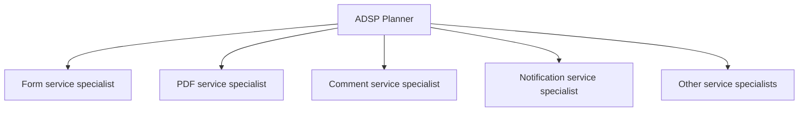
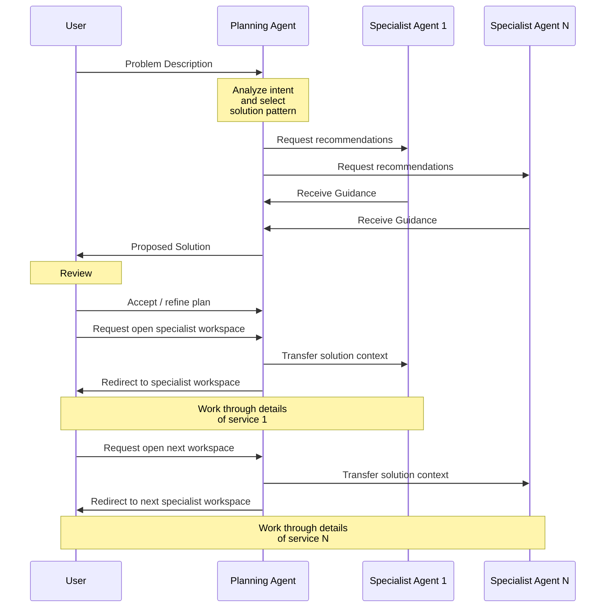

# ADSP Project Planner

## Overview

ADSP’s Tenant Management Webapp (TMW) is an ideal use case for using AI agents to help our customers explore how ADSP can provide solutions to their application requirements. Many potential ADSP users struggle to understand how our services can help the to implement their desired workflows and how those services fit together. The goal of the agents is to reduce this barrier by allowing users to describe the business problem they are trying to solve rather than requiring deep upfront knowledge of ADSP’s architecture and configuration model.

To aid in this endeavour we will add an network of AI agents to TMW that will get the ball rolling, helping users understand what ADSP is, which business problems it can help solve, and sketching out implementation plans for them to refine. The agent network will include a planning agent who’s job would be to discover what what problem the user is trying to solve and then formulate a plan for how ADSP services could help in implementing a solution. The planner would communicate with other agents, each specializing in one ADSP service, to help work out the details:



## The Planner

The planner is the primary point for users to interact with the agents. Its responsibility is to help users describe:

- the business problem they are trying to solve,
- identify whether the problem matches a known GoA solution pattern,
- determine which ADSP services may help implement the solution, and
- coordinate the specialized service agents to assist the user in refining the implementation.

Unlike the specialized service agents, the planner focuses on:

- understanding business goals,
- coordinating workflows across services,
- maintaining overall solution hypotheses,
- and guiding users through the implementation process.

The planner is not expected to have deep implementation knowledge of individual services. Detailed service-specific guidance will instead be delegated to the specialized agents. These ideas are illustrated below:



### The Business Model

Throughout its interaction with the user, the Planner’s primary objective is to construct a structured model of the business problem being solved. Rather than collecting a list of requirements or attempting to immediately recommend ADSP services, the Planner incrementally develops an understanding of the business itself.

As new information is discovered, the Planner identifies and classifies business concepts, their relationships, and any assumptions or uncertainties. Business concepts may include:

- Actors
- Goals
- Activities
- Decisions
- Evidence
- Business Rules
- Constraints
- Evaluation Criteria
- Workflows
- Outcomes
- Documents
- Events
- External Systems
- Assumptions
- Unknowns

The planner should not expect the user to describe these concepts explicitly; it should be able to infer them from the information supplied by the user. As the conversation progresses, the model is refined, corrected, and expanded until there is sufficient confidence that the problem has been understood. Solution hypotheses are then derived from the business model rather than directly from the conversation itself.

The business model serves as the Planner’s working understanding of the problem. It will reason over the business model, not the conversation.

### Responsibilities

The Planner’s primary **responsibility** is to help users explore and understand the business problem they are trying to solve, and to develop one or more solution hypotheses. **Any solution the planner proposes should be considered a hypothesis**, and it should be expected that the use will want to modify, or refine, anything it proposes. The Planner’s **goal** is not to produce a perfect solution, but to develop sufficient confidence in the shared understanding of the problem that implementation can begin.

Solution hypotheses begin with a clear *problem model*, which will require the planner to:

- determine the type of problem the user is trying to solve,
- identify missing information and ask clarifying questions,
- identify whether the problem matches a known GoA solution pattern,
- identify and classify business concepts (such as actors, business rules, evaluation criteria, constraints, assumptions, and workflows).
- construct and refine a problem model,
- develop one or more solution hypotheses,
- determine which ADSP services are relevant,
- coordinate specialized service agents,
- present solutions and recommendations in non-technical language,
- explain its reasoning,
- guide users between specialized workspaces,
- maintain overall solution state across sessions.

### Knowledge Requirements

The planner will require:

- broad conceptual knowledge of ADSP capabilities and services,
- understanding of common GoA business process patterns,
- awareness of recommended ADSP solution patterns,
- understanding of how ADSP services are commonly composed together,
- enough architectural understanding to propose solution approaches,
- but not deep implementation-level knowledge of individual services.

### Reasoning Responsibilities

The planner will need to:

- identify the business problem being described,
- map the problem to one or more known solution patterns,
- determine which information is still missing,
- ask clarifying questions,
- summarize the gathered information into a structured solution model,
- coordinate with specialized agents to refine recommendations,
- determine recommended implementation order and next actions.
- explain its reasoning.

### Persistence

Because some solutions may take days or weeks to complete, the planner will likely need to maintain a persistent solution state between sessions. This state should:

- summarize decisions already made,
- track open questions,
- track specialist-agent progress,
- track generated artifacts and configurations,
- maintain recommended next steps,
- avoid requiring the user to repeat information already gathered.
- track reasoning - i.e. the state should include the planner’s reason for making a decision.

The solution state should be stored in a structured format rather than relying solely on conversation history. JSON could be a good format for this, for example.

### Business Patterns

In addition to the knowledge of ADSPs domain expertise, the planner will also have knowledge of typical business processes that the GoA builds and will endeavour to determine if a user request fits into one of these known patterns. The planner is not intended to replace early project discovery or business analysis. Its role is to recognize common solution patterns well enough to help users map their implementation needs to ADSP services, identify missing information, and guide them into the appropriate service workspaces. This application knowledge can be captured through *templates* that might look something like this:

#### Business Pattern

Give the application type a descriptive name

#### Purpose

Describe what this type of application is for.

#### Common domain language

List words and phrases people commonly use when talking about this type of work.

#### Common features

Describe features this application type often needs.

#### Strong confidence signals

Describe signs that a project probably belongs to this pattern.

#### Weak or misleading signals

Describe signs that may sound related but are not enough by themselves.

#### Likely ADSP service mappings

Describe which ADSP services are commonly useful and why.

#### Clarifying questions

List questions the planner should ask when confidence is low.

#### Assumptions

Capture things we believe are usually true

#### known unknowns

Capture things that need validation.

For example, a case-management application might be described as follows:

#### Business Pattern

Case Management

#### Purpose

To manage records moving through a lifecycle and being handled collaboratively by staff over time.

#### Common Domain Language

[case, request, application, dispute, incident, investigation, claim, review, approval, intake, workflow, escalation, assignment]

#### Common Features

- Applicants submit an intake form.
- Staff review the application for eligibility.
- Staff may request more information.
- The application moves through statuses such as submitted, under review, approved, rejected, or withdrawn.
- Applicants may receive notifications when the status changes.

#### Strong Confidence Signals

Look for evidence that the application involves:

- Long-lived records or “cases”
- Human workflow or review steps
- Status transitions
- Multiple participants or roles
- Notes, comments, or attachments
- Task assignment or escalation
- Audit history
- Repeated updates over time
- Search/filter/reporting of active cases

#### Weak or misleading signals

The following signals may appear in case management applications, but are not sufficient on their own to classify a project as case management:

- A form is submitted by a user.
- Data is stored and viewed later.
- Users receive notifications.
- Staff can search for records.
- Reports are generated.
- Files or documents are uploaded.
- The application has multiple user roles.

#### Likely ADSP service mappings

The following ADSP services are commonly useful in case management solutions:

- **Form Service**
  - Intake forms and data collection.
- **Comment Service**
  - Staff notes, discussions, and case history.
- **File Service**
  - Supporting documents and attachments.
- **Notification Service**
  - Status updates, requests for additional information, and workflow notifications.
- **Value Service**
  - Storage of case-specific business data.
- **Configuration Service**
  - Workflow definitions, status values, and configurable business rules.

Additional services may be required depending on the specific business domain.

#### Clarifying Questions

The planner should consider the following questions when confidence is low:

- Does the submission become a long-lived record after intake?
- Will staff review, approve, reject, or request changes?
- Does the record move through multiple statuses over time?
- Are multiple staff members expected to collaborate on the same record?
- Are comments, notes, or attachments required?
- Will work be assigned to specific individuals or teams?
- Is an audit history required?
- Will users return to view status updates or provide additional information?
- Does the process include escalation, review, or approval steps?

#### Common assumptions

- Records persist beyond initial submission.
- The process involves one or more human review steps.
- Records move through a defined lifecycle.
- Multiple user roles interact with the same record.
- Historical actions and decisions may need to be retained.

#### Known unknowns

- The complexity of the workflow may vary significantly between implementations.
- Some solutions may require formal task management while others do not.
- Some solutions may require external integrations or document management capabilities.
- Security, privacy, and retention requirements are domain-specific and should be validated during discovery.
- Not all case management solutions require every feature listed in this pattern.

We will need to instruct the planner on how to:

- identify the problem users are trying to solve,
- match it to a known solution pattern,
- summarize the information in a JSON structure,
- work with the specialized agents to determine a solution,
- show the user the solution, in user speak, and advise on the implementation,
- aid the user in navigating between specialized agents for detailed help.

### Planning Pipeline

Rather than attempting to reason about every aspect of a solution simultaneously, the Planner should work through the problem incrementally. Its primary goal is to construct and continually refine a business model of the problem being solved. It will then uses this model to develop and evaluate one or more solution hypotheses. Once a hypothesis has been accepted by the user, the Planner can formulate recommendations describing how ADSP capabilities may be used to implement the solution. The pipeline would look something like this:

```text
conversation ↔︎ business model → solution hypotheses → recommendations
```

## The Specialists

Each ADSP service will have its own specialist agent which, in turn, will have a deep understanding of the service it represents. Every service has its own set of options and variations, and it is the responsibility of the specialist to know what they are and when they might be used. Once the planner has determined that the user might need the form service, for example, it would convey this information to the form-service agent who would then respond with some questions about the various options available, something like:

- Do applicants need to save drafts?
- Is the form public or authenticated?
- Are there conditional eligibility questions?
- Are attachments required?
- Does the form create a case/project after submission?
- Does the applicant require a PDF copy of their application?

Depending on the answers it might also respond with a list of dependent services:

- If attachments are required, include File Service.
- If users need a PDF copy, include PDF Service.
- If submissions trigger emails, include Notification Service.
- If access is restricted, include Access Service.

### Specialists have two responsibilities

1. **Guide the planner.** The planner will consult with the specialists to:
   1. determine if the service is a good fit to help deliver a solution,
   2. identify which parts of the proposed solution the service can support,
   3. identify constraints, dependencies, or risks the planner may not have considered,
   4. validate plans the planner is suggesting.
2. **Guide a user directly.** Users may know exactly which service they want to explore and have no need for the planner. The agent will interact with the user directly and:
   1. answer questions,
   2. recommend service-specific solutions,
   3. help refine service-specific designs,
   4. validate solutions

## Usage scenarios

### 1. No requirement specifications

In this case the user may not be a developer. They may be a business analyst or someone else from a ministry trying to discover what it is they need from an application. The planner will be able to talk to them without going into any technical details, and it will engage the user in a conversation about what their business needs are. The goal is to construct a model of the business problem.

When satisfied, the user can proceed to scenario #3.

### 2. Existing requirements

In this case a ministry has supplied some kind of requirements documentation. Users can be developers or business analysts. They well feed the document to the planner to give it all the known information about the project. The planner will then attempt to find missing features and ambiguities in the requirements and ask the user about them. The goal is to construct a complete model of the business problem.

When satisfied, the user can proceed to scenario #3

### 3. Existing application

An application already exists, and the developer is looking to enhance or refactor it to use ADSP services. The user may or may not have a detailed description of the new feature. If so, they will feed it to the planner as in Scenario 2. If not, then the planner will try to determine exactly what the feature is trying to accomplish, as in Scenario 1.

### 4. Existing ADSP application

An application that utilizes some ADSP services already, and the developer is either looking to reconfigure, refactor or add new features. This scenario is almost like #3, except that the planner will have access to the app's existing ADSP configurations and will therefor be equipped to determine whether a new feature is needed or if existing features can be adapted to the problem.

## Appendix

Here are some Application Types that can considered for inclusion:

| Application Type | Description |
|---|---|
| Case Management | Manage a long-running work item or business process involving collaboration, tasks, notes, files, status tracking, audit history, and multiple stages of work |
| Grant Applications | Accept, review, approve, monitor, and track funding applications, including applicant intake, supporting documents, reviewer workflows, notifications, and reporting |
| Permit / licence application | Apply, review, approve, renew, suspend, expire |
| Registration / enrollment | Register a person, organization, facility, program, asset, or activity |
| Inspection / compliance | Schedule inspection, record findings, issue actions, track remediation |
| Complaint / concern intake | Receive complaint, triage, assign, investigate, respond |
| Consultation / feedback collection | Gather stakeholder/public feedback, summarize themes, report outcomes |
| Benefit / eligibility assessment | Determine whether someone qualifies for a program or service |
| Appointment / booking request | Request, schedule, confirm, reschedule, notify |
| Document submission / package review | Upload required files, validate completeness, review, request changes |
| Incident / emergency response reporting | Capture event details, coordinate response, log actions |
| Information request / FOIP-style request | Intake request, assign analyst, gather records, respond |
| Referral / routing workflow | Send a request to the right ministry/team/program based on rules |
| Status tracking portal | Let applicants/clients see where their request is in the process |
| Audit / evidence trail | Record who did what, when, and why |
| Public reporting / data collection | Collect recurring reports from municipalities, agencies, operators, etc. |
| Template-driven document generation | Generate letters, certificates, summaries, notices, decision documents |
| Notification campaign / subscription | Let users subscribe to updates, send alerts, reminders, announcements |
| Internal service request | Request support from a shared service team: forms, IT, comms, legal, procurement-ish stuff |
